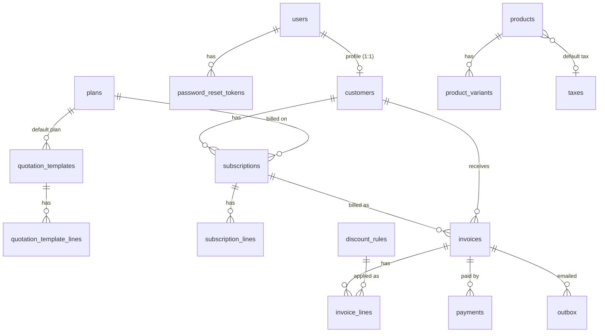

# Brightloop Subscription Management: Data Model (8-hour MVP)

PostgreSQL schema, managed with SQLAlchemy 2 and Alembic migrations. Companion to `UX_DESIGN.md` and `TECH_STACK.md`. Cut items are in section 9.

## 1. Principles

- **Invoices are immutable snapshots.** Invoice lines copy price, tax name and tax rate at creation, so editing a product, tax or discount later never changes an issued invoice.
- **The database enforces the rules that matter**: no double billing, no overpayment, one email per account. These are the rules we demo.
- **Money is `NUMERIC(12,2)`**, never floats.
- **Derived values are not stored** when they can go stale: "overdue", "balance due" and discount usage are computed. `amount_paid` is the one deliberate denormalization.
- Every table has `id` (bigint identity primary key), `created_at` and `updated_at`.

## 2. Tables at a glance (16)

| Area | Tables |
|---|---|
| Identity | `users`, `customers`, `password_reset_tokens` |
| Catalog | `taxes`, `products`, `product_variants`, `plans` |
| Quotes | `quotation_templates`, `quotation_template_lines` (seeded, no UI) |
| Subscriptions | `subscriptions`, `subscription_lines` |
| Billing | `invoices`, `invoice_lines`, `payments` |
| Discounts | `discount_rules` |
| Email | `outbox` |

## 3. Enums

| Enum | Values |
|---|---|
| `user_role` | `admin`, `staff`, `customer` |
| `billing_period` | `daily`, `weekly`, `monthly`, `yearly` |
| `subscription_status` | `draft`, `quotation`, `confirmed`, `active`, `closed` |
| `invoice_status` | `draft`, `confirmed`, `paid`, `cancelled` |
| `invoice_line_type` | `product`, `discount` |
| `payment_method` | `cash`, `bank_transfer`, `card`, `online`, `other` |
| `value_type` | `percent`, `fixed` (used by taxes and discounts) |
| `discount_scope` | `subscription`, `product` |
| `email_type` | `password_reset`, `invoice` |

## 4. Tables

### 4.1 Identity

**`users`**: email (unique, stored lowercased), password_hash (argon2 or bcrypt), full_name, role (`user_role`), is_active. Staff are deactivated, never deleted.

**`customers`** (business profile; a staff member can create one before the person signs up): user_id (nullable, unique FK to users), name, company (nullable), email, phone (nullable), address (nullable).

**`password_reset_tokens`**: user_id (FK), token (unique, random), expires_at, used_at (nullable; set on use, so links are single-use). The MVP stores the token as is; hashing it is a later hardening step.

### 4.2 Catalog

**`taxes`**: name, type (`value_type`), value, is_active.

**`products`**: name, type, sales_price (check >= 0), tax_id (nullable FK), is_active.

**`product_variants`**: product_id (FK), attribute (e.g. "Brand"), value (e.g. "Odoo"), extra_price (e.g. 560). Unique (product_id, attribute, value). Final unit price = `sales_price + extra_price`.

**`plans`**
| Column | Type | Notes |
|---|---|---|
| name | text | |
| price | numeric(12,2) | check >= 0 |
| billing_period | billing_period | |
| min_quantity | integer | check >= 1 |
| available_from | date | |
| available_to | date | nullable; check >= available_from |
| auto_close | boolean | the subscription closes itself when the plan ends |
| allow_early_close | boolean | shows "Close early" in the portal |
| is_active | boolean | |

### 4.3 Quotation templates (seeded; no management UI)

**`quotation_templates`**: name, plan_id (FK), validity_days (check > 0).

**`quotation_template_lines`**: template_id (FK), product_id (FK), variant_id (nullable FK), quantity (check > 0). A new quote copies these lines into real subscription lines.

### 4.4 Subscriptions

**`subscriptions`**
| Column | Type | Notes |
|---|---|---|
| number | text | unique, e.g. `SUB-0001`, from a sequence |
| customer_id | bigint | FK |
| plan_id | bigint | FK |
| status | subscription_status | |
| start_date | date | |
| expiry_date | date | nullable; check >= start_date |
| payment_terms_days | integer | e.g. 15 for "Net 15"; gives the invoice due date |
| next_billing_date | date | nullable; set when the subscription becomes active |

**`subscription_lines`**: subscription_id (FK, on delete cascade), product_id (FK), variant_id (nullable FK), quantity (check > 0), unit_price (copied from the product plus variant when the line is added). Tax comes from the product's default tax at billing time.

### 4.5 Invoices

**`invoices`**
| Column | Type | Notes |
|---|---|---|
| number | text | unique, e.g. `INV-0001`, from a sequence |
| subscription_id | bigint | FK |
| customer_id | bigint | FK |
| period_start | date | |
| period_end | date | check >= period_start |
| status | invoice_status | |
| issue_date | date | |
| due_date | date | |
| subtotal | numeric(12,2) | |
| discount_total | numeric(12,2) | stored as a positive number |
| tax_total | numeric(12,2) | |
| total | numeric(12,2) | check >= 0 |
| amount_paid | numeric(12,2) | check between 0 and total |

**Unique (subscription_id, period_start)** is the database-level guarantee against double billing.

**`invoice_lines`**: invoice_id (FK, on delete cascade), line_type (`invoice_line_type`), description, quantity, unit_price (negative for discount lines), tax_name (nullable), tax_rate (nullable), tax_amount, line_total, discount_rule_id (nullable FK; set on discount lines).

### 4.6 Discounts

**`discount_rules`**: name, type (`value_type`), value (check > 0; percent check <= 100), min_purchase (nullable), min_quantity (nullable), start_date, end_date (nullable; check >= start_date), usage_limit (nullable = unlimited), scope (`discount_scope`), product_id (nullable FK; used when scope = `product`), is_active.

**Usage is counted, not stored:** `used = count of invoice_lines with this discount_rule_id on non-cancelled invoices`. A partial unique index on (invoice_id, discount_rule_id) where line_type = `discount` stops the same rule being applied twice to one invoice. Cancelling an invoice frees its use automatically.

UI status is derived: **Active**, **Expired** (past end_date) or **Exhausted** (used >= usage_limit).

### 4.7 Payments

**`payments`**: invoice_id (FK), customer_id (FK), method (`payment_method`), amount (check > 0), payment_date, note (nullable), recorded_by (nullable FK to users; null for online payments).

**Keeping `invoices.amount_paid` in sync:** one transaction locks the invoice row (`SELECT ... FOR UPDATE`), checks `amount <= total - amount_paid`, inserts the payment, updates `amount_paid`, and sets status to `paid` when the balance reaches zero. Staff payments and the mock checkout share this code path (the checkout uses method `online`).

### 4.8 Outbox

**`outbox`**: type (`email_type`), to_email, subject, body_html, invoice_id (nullable FK), created_at. Emails are log-only; nothing is sent over SMTP.

## 5. Indexes

| Table | Index | Serves |
|---|---|---|
| users | unique (email) | login; one account per email |
| subscriptions | (status, next_billing_date) | billing day "what's due" query |
| subscriptions | (customer_id) | customer page, portal |
| invoices | unique (subscription_id, period_start) | double-billing guard |
| invoices | (status, due_date) | overdue list and dashboard |
| invoices | (customer_id), (issue_date) | customer page, date filters |
| payments | (invoice_id), (payment_date) | invoice balance, revenue by date |
| invoice_lines | (discount_rule_id) | discount usage counts |

## 6. Derived rules

- **Overdue:** `status = 'confirmed' AND amount_paid < total AND due_date < today`. Days overdue = `today - due_date`.
- **Balance due:** `total - amount_paid`.
- **Due date:** `issue_date + payment_terms_days`.
- **Dashboard:**
  - Active subscriptions: count where status is `active`.
  - Revenue collected: sum of `payments.amount` by `payment_date`.
  - Outstanding: sum of `total - amount_paid` on confirmed invoices.
  - MRR: active subscriptions' recurring amounts normalized to a month (daily, weekly and yearly plans converted).

## 7. Billing run logic

`POST /billing/run` (the Billing Run page and, later, a scheduler both call it). For each selected due subscription, in its own transaction:

1. Select subscriptions where `status = 'active'` and `next_billing_date <= today`.
2. Build the invoice from the subscription lines. Copy the price, and the tax name and rate from the product's tax, onto the invoice lines.
3. Add a discount line for each rule that is active, in date range, not exhausted, and whose scope, minimum purchase and minimum quantity match. A percent discount applies to the subtotal; a fixed discount applies once per invoice. **Tax is calculated on the discounted amount.**
4. Insert the invoice as `draft` (or `confirmed` if "Confirm after creating" was ticked), with its lines.
5. Advance `next_billing_date` by the plan's period. If the subscription has passed `expiry_date`, or the plan ended and `auto_close` is set, set status `closed`.
6. Record the outcome in the response only: **created**, **skipped** (with a reason, such as an existing invoice for that period) or **failed** (with a reason).

A repeated run hits the unique (subscription_id, period_start) constraint and reports `skipped`, so nothing is billed twice. One failure does not stop the batch.

## 8. Assumptions (replacing the earlier open questions)

- **Pause and Renew are out of the MVP.** The five statuses match the statement's lifecycle.
- **Fixed discounts** apply once per invoice; **percent discounts** apply to the subtotal.
- **Tax is calculated after the discount.**
- **Subscription lines carry no tax snapshot**; tax is looked up from the product at billing time and snapshotted on the invoice.

## 9. Later (cut from the MVP)

- `billing_runs` and `billing_run_items` tables (run history page).
- Hashed reset tokens.
- `discount_rule_products` (a rule can target many products); `discount_redemptions` table (usage is counted from invoice lines instead).
- Product `cost_price` and `notes`, payment `reference`, `created_by` fields. (The statement names cost price and notes, so add these first if there is slack time.)
- `allow_pause`, `allow_renew` plan flags, and `paused_at` on subscriptions.
- Price and tax snapshots on subscription lines.
- Quote validity tracking (`quote_valid_until`) and template management.
- `reminder` and `quotation` email types.
