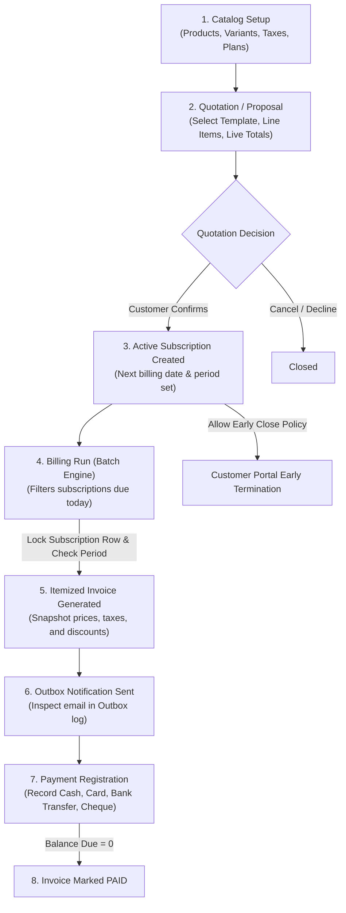

# Brightloop — Unified Subscription & Recurring Billing Platform

> **Automate recurring subscriptions. Eliminate double-billing. Gain complete revenue visibility.**  
> A production-grade subscription management and automated billing platform built for **Make-A-Ton 9.0**, engineered with strict database integrity, idempotency, and a clean modern aesthetic.

---

## 📌 Table of Contents
1. [Overview & Architecture](#1-overview--architecture)
2. [All Credentials (Demo Logins)](#2-all-credentials-demo-logins)
3. [End-to-End Business Workflow](#3-end-to-end-business-workflow)
4. [Core Features & System Modules](#4-core-features--system-modules)
   - [Authentication & Role-Based Access Control](#41-authentication--role-based-access-control)
   - [Finance & Operational Dashboards](#42-finance--operational-dashboards)
   - [Product Catalog & Live Variant Pricing](#43-product-catalog--live-variant-pricing)
   - [Subscription Plans & Policy Rules](#44-subscription-plans--policy-rules)
   - [Quotations & Lifecycle State Machine](#45-quotations--lifecycle-state-machine)
   - [Idempotent Automated Billing Run](#46-idempotent-automated-billing-run)
   - [Invoicing, Outbox & Payment Reconciliation](#47-invoicing-outbox--payment-reconciliation)
   - [Customer Self-Service Portal](#48-customer-self-service-portal)
   - [Taxes, Discounts & Staff Configuration](#49-taxes-discounts--staff-configuration)
5. [Tech Stack](#5-tech-stack)
6. [Getting Started & Local Setup](#6-getting-started--local-setup)
   - [Prerequisites](#prerequisites)
   - [Database Setup (Docker PostgreSQL 16)](#1-database-setup-docker-postgresql-16)
   - [Backend Setup (FastAPI + SQLAlchemy)](#2-backend-setup-fastapi--sqlalchemy)
   - [Frontend Setup (React + Vite + TypeScript)](#3-frontend-setup-react--vite--typescript)
7. [Database Seeding & Benchmark Scale](#7-database-seeding--benchmark-scale)
8. [Useful Developer Commands & Tests](#8-useful-developer-commands--tests)
9. [API Documentation](#9-api-documentation)

---

## 1. Overview & Architecture

Brightloop replaces fragmented spreadsheets and manual billing operations with a cohesive, audit-compliant platform. It connects products, plans, quotation templates, recurring subscriptions, batch billing runs, payment ledgers, and revenue telemetry into one unified engine.

```
┌────────────────────────────────────────────────────────────────────────┐
│                        React 18 SPA (Vite)                             │
│     Admin Console (Finance)  │  Staff Ops  │  Customer Portal (/portal)│
└───────────────────────────────────┬────────────────────────────────────┘
                                    │ HTTP / REST (JSON)
                                    ▼
┌────────────────────────────────────────────────────────────────────────┐
│                        FastAPI (Python 3.12+)                          │
│   • Auth (HTTP-only Session Cookies)  • Billing Engine (Idempotency)   │
│   • Period Math & Discounts           • Outbox Notification Simulator  │
└───────────────────────────────────┬────────────────────────────────────┘
                                    │ SQLAlchemy 2.0 (ORM + Core)
                                    ▼
┌────────────────────────────────────────────────────────────────────────┐
│                        PostgreSQL 16 Engine                            │
│   • Check Constraints                 • Unique (subscription, period)  │
│   • Row-Level Locks (SELECT FOR UPDATE)                                │
└────────────────────────────────────────────────────────────────────────┘
```

### Key Architectural Highlights:
- **Client Frontend (`frontend/`)**: React 18, TypeScript, Vite, Tailwind CSS, Lucide Icons, Recharts, and Framer Motion. Features dark/light themes, live quotation totals, printable invoice dialogs, batch progress modals, and role-based shell isolation.
- **Backend API (`backend/`)**: FastAPI, SQLAlchemy 2.0, Pydantic v2, Alembic migrations, and Argon2-based password hashing.
- **Database Engine**: PostgreSQL 16 with check constraints and unique compound constraints on `(subscription_id, period_start)` to guarantee zero double-billing even under concurrent execution.

---

## 2. All Credentials (Demo Logins)

The database comes seeded with **400 customers, 3,000 subscriptions, and ~9,700 invoices** via `python seed.py`, providing immediate volume for testing filters, pagination, and KPI metrics.

### 🔐 Demo Accounts Table

| Role | Email | Password | Landing Page | Accessible Scope & Privileges |
| :--- | :--- | :--- | :--- | :--- |
| **Administrator** | `admin@brightloop.com` | `Admin@123` | `/dashboard` | **Full Back-Office Access**: Complete financial KPI telemetry (MRR, Total Revenue), Catalog (Products, Variants, Plans), Configuration (Taxes, Discounts, Staff), Subscriptions, Invoices, Outbox, and Customers. |
| **Staff Member** | `staff@brightloop.com` | `Staff@123` | `/dashboard` | **Operations Console**: Operational dashboard (active subscriptions count, overdue alerts; financial MRR/revenue charts hidden), Customer directory, Quotations, Invoices, Billing Run, and Outbox. |
| **Customer 1** | `acme@example.com` | `Customer@123` | `/portal/subscriptions` | **Customer Portal**: Isolated strictly to Acme Robotics records. View subscriptions, trigger conditional early termination, inspect invoices, and test mock checkout. |
| **Customer 2** | `globex@example.com` | `Customer@123` | `/portal/subscriptions` | **Customer Portal**: Isolated to Globex Logistics data. |
| **Customer 3** | `initech@example.com` | `Customer@123` | `/portal/subscriptions` | **Customer Portal**: Isolated to Initech Systems data. |

> [!NOTE]
> All user passwords require **8+ characters**, at least one uppercase letter, one lowercase letter, and one special character. The login and registration forms include live inline validation checklists.

---

## 3. End-to-End Business Workflow

The recurring revenue cycle in Brightloop follows a strict, auditable sequence:



### Workflow Steps:
1. **Catalog Setup**: Admin defines products, variant price surcharges (e.g. *Brand: Odoo +$560*), tax rates (percent or fixed fee), and billing plans (Daily, Weekly, Monthly, Yearly).
2. **Quotation & Proposal**: Staff selects a customer and quotation template (or starts blank). Line items, quantities, and discounts compute live subtotal, taxes, and grand totals.
3. **Lifecycle Progression**: The quote moves through the state machine: `Draft` → `Quotation` → `Confirmed` → `Active`.
4. **Automated Billing Run**: The engine identifies subscriptions where `next_billing_date <= today`. Subscriptions are billed in an atomic transaction; re-running the same period safely skips previously billed items.
5. **Invoice Dispatch & Payment**: Invoices are confirmed and sent (queueing a previewable notice to the Outbox). Staff or customers register payments until the balance reaches zero.

---

## 4. Core Features & System Modules

### 4.1 Authentication & Role-Based Access Control
- Secure HTTP-only session cookies with role claims (`admin`, `staff`, `customer`).
- Strict backend API dependency guards (`get_current_user`, `require_admin`, `require_staff`).
- Single-use, time-limited SHA-256 password reset tokens with outbound links logged to the simulated Outbox.
- Built-in UI role switcher in the header to easily demonstrate different role perspectives during reviews.

### 4.2 Finance & Operational Dashboards (`/dashboard`)
- **Admin Financial Telemetry**: Real-time KPI cards for **MRR (Monthly Recurring Revenue)**, **Active Subscriptions**, **Total Revenue Collected**, **Outstanding Balance**, and **Overdue Invoices**.
- **Dynamic Date Filter**: Live date range picker driving aggregate metrics and Recharts revenue trend line/area chart.
- **Staff Operational View**: Financial revenue cards are automatically hidden for staff users, presenting operational counts and overdue account alerts.

### 4.3 Product Catalog & Live Variant Pricing (`/catalog/products`)
- Server-paginated, searchable, and sortable product listings with category tags (Software, Service, Hardware).
- **Add / Edit Product Drawer**: Name, sales price, cost price (for margin tracking), default tax rule, and internal notes.
- **Variant Engine**: Inline attribute management (e.g., *Edition: Professional*, *Size: 1 TB*) with real-time **Live Final Price** calculation (`Base Price + Variant Surcharge`).

### 4.4 Subscription Plans & Policy Rules (`/catalog/plans`)
- Multi-cadence support: **Daily**, **Weekly**, **Monthly**, and **Yearly**.
- Minimum order quantity / seat thresholds.
- Contract policy toggles:
  - `allow_early_close`: Controls whether the customer portal displays the "Close Early" cancellation action.
  - `auto_close`: Automatically moves subscription to `Closed` when the expiry date is reached instead of renewing.

### 4.5 Quotations & Lifecycle State Machine (`/sales/subscriptions`)
- Pre-seeded quotation templates (e.g., *Starter CRM*, *Team Workspace*, *Enterprise Annual*).
- Interactive line item editor with dynamic variant selector and sticky live totals summary panel (Subtotal, Discounts, Taxes, Grand Total).
- Strict state stepper: `Draft` → `Quotation` → `Confirmed` → `Active` → `Closed` with contextual action buttons and browser contract print view.

### 4.6 Idempotent Automated Billing Run (`/billing/run`)
- Table of due subscriptions with checkboxes, prior billing warnings, and select-all controls.
- **Batch Generator**: Executes billing with live progress feedback.
- **Idempotency Summary Modal**: Displays Created, Skipped, and Failed counts with itemized skip reasons (e.g. *"Already billed for period 2026-10-01 to 2026-10-31"*), demonstrating double-billing protection.

### 4.7 Invoicing, Outbox & Payment Reconciliation (`/billing/invoices`, `/billing/outbox`)
- Invoice detail stepper (`Draft` → `Confirmed` → `Paid`) with overdue badge indicators.
- **Printable Invoices**: Native browser print dialog rendering a clean, formal invoice print sheet.
- **Outbox Simulator (`/billing/outbox`)**: Log table of outbound notifications (Password reset links, Invoice notices) with expandable sandboxed iframe email previews.
- **Payment Register Drawer**: Record partial or full payments across **Cash**, **Bank Transfer**, **Credit Card**, and **Cheque**, updating invoice balances and payment ledgers immediately.

### 4.8 Customer Self-Service Portal (`/portal`)
- Streamlined, mobile-first portal restricted strictly to the authenticated customer's data.
- **My Subscriptions (`/portal/subscriptions`)**: Card/grid overview, next billing dates, linked invoices, and conditional "Close early" button with confirmation modal.
- **Invoices (`/portal/invoices`)**: Invoice breakdown, printable view, and Mock Checkout modal ("Test Mode") allowing editable partial payment simulation.

### 4.9 Taxes, Discounts & Staff Configuration (`/config`)
- **Taxes (`/config/taxes`)**: Percentage rates (e.g. GST 18%) or fixed fee levies with instant Active/Inactive toggles.
- **Discounts (`/config/discounts`)**: Percentage or fixed rules, minimum purchase thresholds, usage limit caps (e.g. `12 / 50 uses`), and scope controls (Whole Subscription vs Single Product).
- **Staff Management (`/config/staff`)**: Add internal staff, issue credentials, and soft-deactivate/reactivate users without deleting historical records.

---

## 5. Tech Stack

| Layer | Technologies | Purpose |
| :--- | :--- | :--- |
| **Frontend** | React 18, TypeScript, Vite, React Router v7 | Fast, type-safe client-side application |
| **Styling & UI** | Tailwind CSS, Lucide Icons, Framer Motion | Modern interface inspired by Linear and Stripe |
| **Data Viz** | Recharts | Revenue trends and financial metric charts |
| **Backend** | Python 3.12+, FastAPI, Pydantic v2 | High-throughput asynchronous REST API |
| **Database ORM** | SQLAlchemy 2.0, Alembic | Declarative data models and schema migrations |
| **Database** | PostgreSQL 16 (Docker) | ACID-compliant relational data store |
| **Security** | Argon2 / Passlib, HTTP-only Cookies | Industry-standard password hashing and auth |

---

## 6. Getting Started & Local Setup

### Prerequisites
- **Docker & Docker Compose** (v2+)
- **Python** (v3.12 or newer)
- **Node.js** (v20 or newer) and `npm`

---

### 1. Database Setup (Docker PostgreSQL 16)

From the project root:
```bash
# Copy example environment configuration
cp .env.example .env

# Start PostgreSQL 16 container in background
docker compose up -d db
```
*PostgreSQL will be accessible at `localhost:5432` (User: `brightloop`, DB: `brightloop`).*

---

### 2. Backend Setup (FastAPI + SQLAlchemy)

```bash
cd backend

# Create and activate virtual environment
python3 -m venv .venv
source .venv/bin/activate    # On Windows: .venv\Scripts\activate

# Install dependencies
pip install -r requirements.txt

# Run migrations to latest schema
alembic upgrade head

# Seed demo data (logins, catalog, 400 customers, 3k subscriptions, 9.7k invoices)
python seed.py

# Start the FastAPI server
uvicorn app.main:app --reload --port 8000
```
*API will be live at `http://localhost:8000`. Test health: `curl http://localhost:8000/health`.*

---

### 3. Frontend Setup (React + Vite + TypeScript)

In a separate terminal:
```bash
cd frontend

# Install npm packages
npm install

# Start Vite dev server
npm run dev
```

Open your browser at:  
👉 **[http://localhost:5173](http://localhost:5173)**

---

## 7. Database Seeding & Benchmark Scale

The seed script (`backend/seed.py`) generates deterministic, mathematically sound demo data:
```bash
# Seed standard demo dataset
python seed.py

# Wipe and reseed an empty database
python seed.py --reset
```

### Seeded Volume Summary:
- **Users**: Admin, Staff, and 3 named demo customer accounts.
- **Catalog**: 3 Tax rules, 8 Products (with variants), 7 Plans, 3 Quotation templates, 4 Discount rules.
- **Scale**: 400 realistic enterprise customers, 3,000 subscriptions, and ~9,700 invoices with diverse states (Draft, Confirmed, Paid, Partial, Overdue, Cancelled).

---

## 8. Useful Developer Commands & Tests

| Action | Command | Location |
| :--- | :--- | :--- |
| **Run Backend Test Suite** | `pytest` | `backend/` |
| **Run Focused Billing Tests** | `pytest tests/test_billing_due.py` | `backend/` |
| **Run Subscription API Tests** | `pytest tests/test_subscriptions.py` | `backend/` |
| **Typecheck Frontend** | `npm run build` *(runs `tsc -b && vite build`)* | `frontend/` |
| **Open Postgres SQL Shell** | `docker compose exec db psql -U brightloop -d brightloop` | Root |
| **Stop All Containers** | `docker compose down` | Root |

---

## 9. API Documentation

FastAPI automatically generates interactive OpenAPI documentation:

- **Swagger UI**: [http://localhost:8000/docs](http://localhost:8000/docs)
- **ReDoc UI**: [http://localhost:8000/redoc](http://localhost:8000/redoc)
- **OpenAPI JSON**: [http://localhost:8000/openapi.json](http://localhost:8000/openapi.json)
